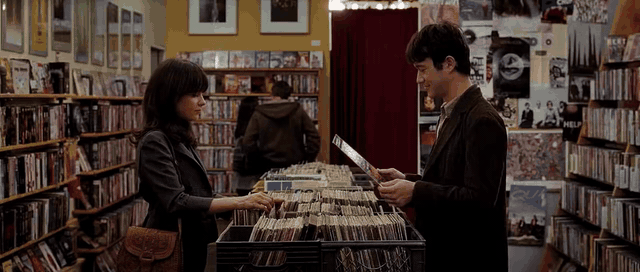
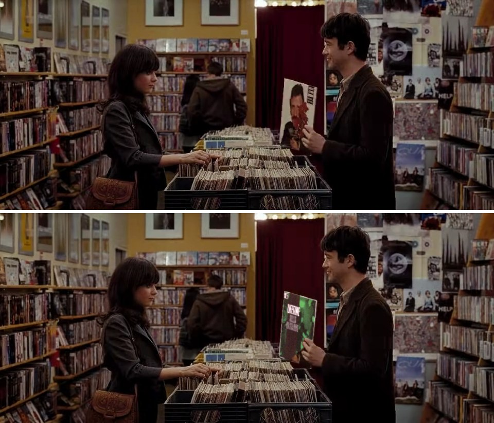
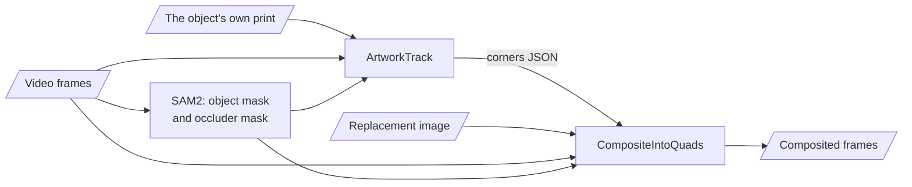
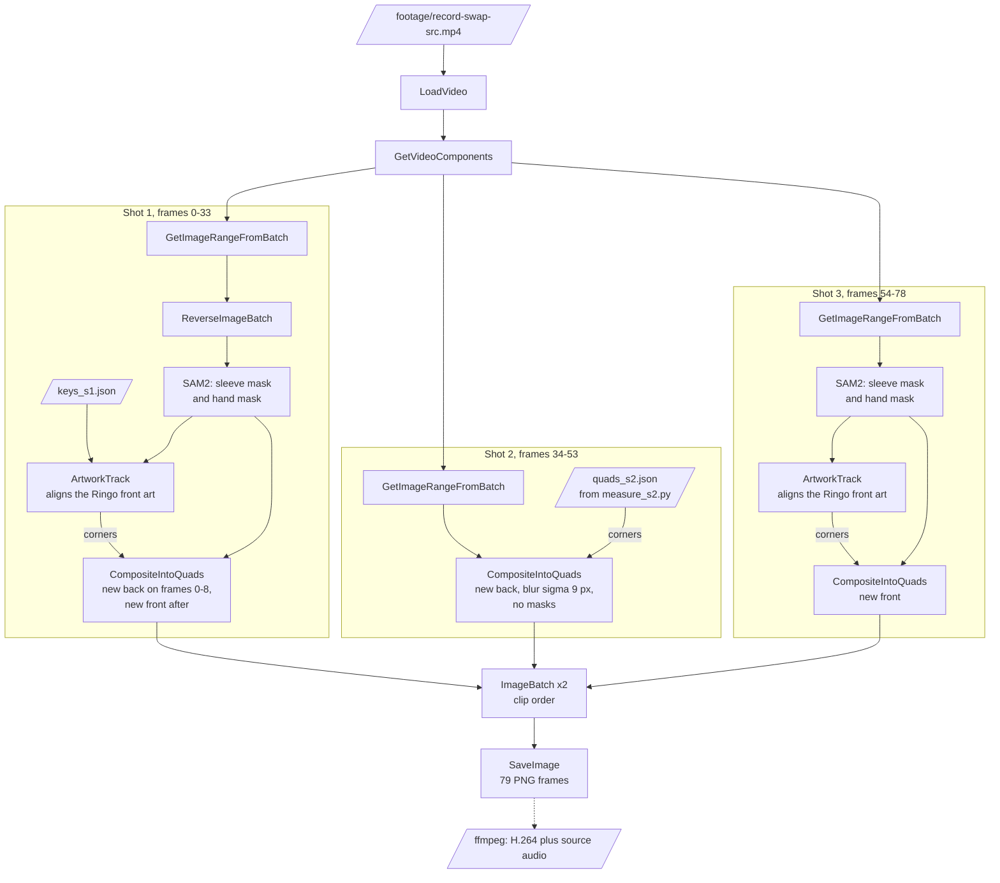
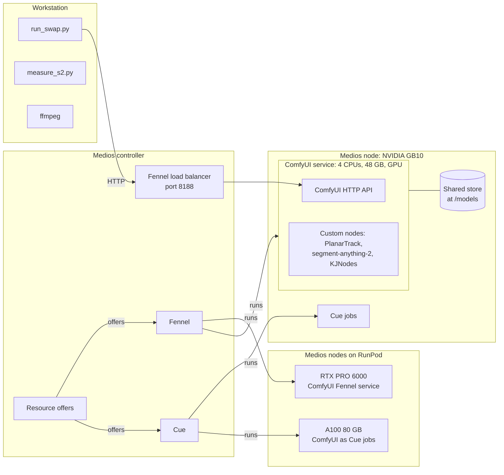
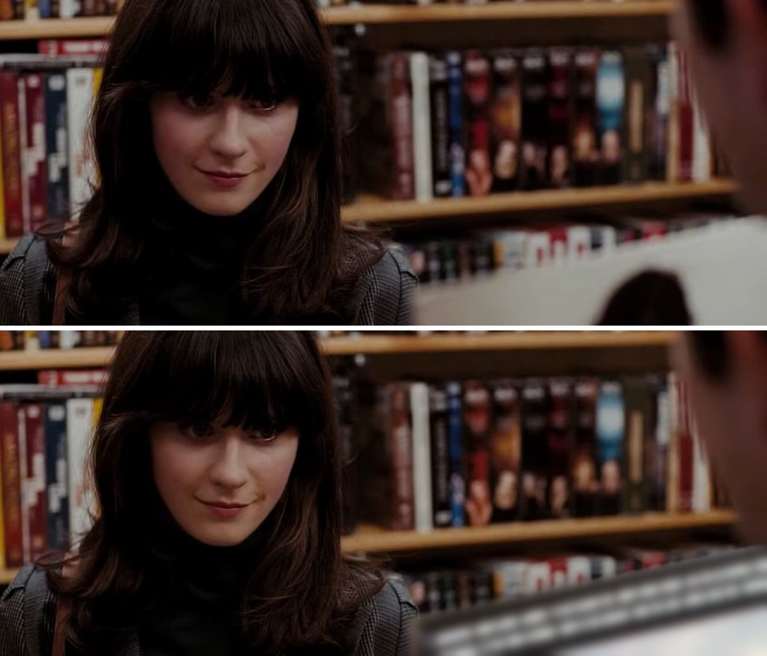
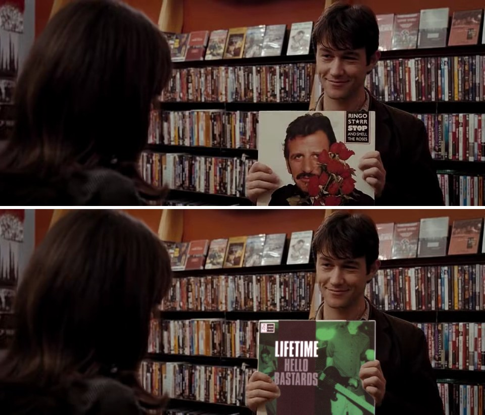

# Record swap: replacing an album sleeve in a 500 Days of Summer shot

<p align="center"><a href="results/record-swap.mp4"></a></p>
<p align="center"><em>Figure 1. The finished 3.3 s clip, all three shots, looping without sound. Click it for the mp4 with the film's sound.</em></p>

This report describes how a 3.3 s clip from *(500) Days of Summer* was edited so that the record Tom holds in the record-shop scene is Lifetime's *Hello Bastards* (Jade Tree, 1995) instead of Ringo Starr's *Stop and Smell the Roses* (1981). The edit replaces both faces of the sleeve wherever they appear, re-grades the new art to the footage, and adds the footage's grain. The sound is the film's own. The result is [`results/record-swap.mp4`](results/record-swap.mp4).

The main contribution of this work is [ComfyUI-PlanarTrack](#comfyui-planartrack), a ComfyUI node pack in this directory that tracks a flat object through a shot and composites a new image onto it, behind the hands that hold it. The rest of the edit uses existing ComfyUI nodes, with SAM2 for segmentation.

<p align="center"></p>
<p align="center"><em>Figure 2. Shot 1, frame 22. Top: the source, with Tom holding up Ringo Starr's <i>Stop and Smell the Roses</i>. Bottom: the result, with the <i>Hello Bastards</i> front tracked onto the sleeve and matched to the film's grade and grain. His fingers stay in front of the new cover.</em></p>

## ComfyUI-PlanarTrack

ComfyUI-PlanarTrack is a ComfyUI node pack for planar replacement. It follows a flat object, such as an album sleeve, a sign or a phone screen, through a shot, and puts a new image onto that object in every frame. Hands and anything else that passes in front of the object stay in front of the new image. Compositors usually do this job in a dedicated planar tracker such as Mocha. ComfyUI's built-in nodes, and the node packs this example uses alongside it, can segment an object but cannot find its corners or warp an image onto it, so this pack adds those steps.

The pack is one Python file, [`ComfyUI-PlanarTrack/__init__.py`](ComfyUI-PlanarTrack/__init__.py), and needs only OpenCV and NumPy beyond what ComfyUI already installs.

### How the nodes connect

The nodes pass corners to each other as a JSON string with one entry per frame. Each entry holds four `[x, y]` points in frame pixels, ordered top-left, top-right, bottom-right, bottom-left. A corner may lie outside the frame, which is how a sleeve that runs off the edge of the picture keeps its true shape. Any node that writes this format can feed the compositor, and a hand-measured file works too: shot 2 of this example uses one.



<p align="center"><em>Figure 3. The pack's path through a shot. SAM2 masks the object and the hands in front of it; ArtworkTrack finds the object's four corners in every frame; CompositeIntoQuads warps the replacement image into those corners and blends it in behind the hands.</em></p>

### The nodes

| Node | Takes | Gives | Used in this example |
|---|---|---|---|
| ArtworkTrack | Frames, the object's original print, object and occluder masks, optional hand-set corners for hard frames | Corners JSON and a per-frame log of how each frame was solved | Shots 1 and 3 |
| CompositeIntoQuads | Frames, the replacement image, corners JSON, object and occluder masks, an optional second image for the first frames | Composited frames and the blend mask | All three shots |
| PlanarTrack | Frames, four corners set by hand on one frame, optional object mask | Corners JSON and a log | No |
| MaskToQuads | Object masks | Corners JSON | No |

ArtworkTrack is the tracker to use when you have a clean image of the object's print. It aligns that print to every frame, so all four corners come from the printed surface, including corners that a hand or the frame edge hides. On this footage it replaced MaskToQuads, which fits corners to the visible outline of the mask and therefore has to guess at hidden ones: its bottom-right corner in shot 1 sat about 45 px from where the print puts it. Section 4 describes ArtworkTrack's three steps of anchor, propagation and acceptance.

PlanarTrack covers objects whose print you do not have. You set the four corners on one frame, and it follows the texture inside them with SIFT matches, falling back to intensity alignment and then to the mask's outline when motion blur leaves too few matches. MaskToQuads is the cheapest option and suits objects whose corners stay visible.

CompositeIntoQuads does the work that makes the replacement sit in the footage rather than on top of it:

- It keeps occluders in front. Pixels under the occluder mask always keep the footage, so fingers stay over the new cover.
- It confines the new art to the object. Inside the quad, art replaces only pixels within the convex hull of the object mask, so a corner that overshoots past a hand does not paint the background.
- It matches the footage's look. It blurs the art to the shot's focus, moves its colour statistics part of the way to those of the pixels it replaces, and adds grain measured from the footage.
- It can switch images partway through a shot. A second image covers the first frames, which is how shot 1 shows the sleeve's back before Tom turns it to the front.

Section 6 gives each step with its parameters.

### Using it on other footage

Copy `ComfyUI-PlanarTrack/` into ComfyUI's `custom_nodes` directory, make sure OpenCV is in ComfyUI's Python environment, and restart ComfyUI: it loads node packs only at start, so any change to the pack also needs a restart. The nodes appear under the `planar_track` category.

A shot needs these inputs:

- Masks for the object and for whatever passes in front of it. This example makes them with ComfyUI-segment-anything-2, prompted with a few click points on one frame.
- For ArtworkTrack, an image of the object's print, upright and cropped to its four corners. For PlanarTrack, four corners on one frame instead.
- Hand-set corners for frames where the object is edge-on or smeared by motion, if the track log reports those frames as held rather than aligned.

The pack assumes the object is flat and rigid. A bent sleeve or a curved screen will not fit a four-corner warp. When an object is so far out of focus that no printed detail survives, neither tracker can lock on, and its corners have to be measured from the frame, as section 5 does for shot 2.

`ComfyUI-PlanarTrack/test_composite.py` checks the compositor's blend-mask rules on synthetic frames without ComfyUI or torch.

## Files

| Path | What it is |
|---|---|
| `ComfyUI-PlanarTrack/` | The node pack (`__init__.py`) and a test of the composite's blend mask on synthetic frames |
| `workflow/run_swap.py` | Builds the whole workflow, queues it on a ComfyUI server, and downloads the frames, masks and corner JSON |
| `workflow/keys_s1.json` | Hand-set starting corners for shot 1, frames 0 to 9 |
| `workflow/measure_s2.py`, `workflow/quads_s2.json` | The shot 2 corner measurement and its output |
| `art/` | The original sleeve (front and back) and the replacement (front and back) |
| `footage/record-swap-src.mp4` | The trimmed 79-frame source clip with its original audio |
| `results/` | The finished clip, a silent looping GIF of it, and a before/after frame for each shot |

## Reproduce

The ComfyUI server needs ComfyUI-segment-anything-2 (with `sam2.1_hiera_large.safetensors`), ComfyUI-KJNodes and this directory's ComfyUI-PlanarTrack in `custom_nodes`, and OpenCV in its Python environment. From this directory:

```sh
uv run --with numpy --with opencv-python-headless python workflow/measure_s2.py \
  footage/record-swap-src.mp4 art/ringo-back-1981.jpg
COMFY_URL=http://your-comfy-host:8188 python3 workflow/run_swap.py \
  footage/record-swap-src.mp4 art/hello-bastards-front.jpg art/hello-bastards-back.jpg out/
ffmpeg -framerate 24000/1001 -pattern_type glob -i 'out/frame_*.png' -i footage/record-swap-src.mp4 \
  -map 0:v -map 1:a -c:v libx264 -crf 16 -preset slow -pix_fmt yuv420p -c:a aac -b:a 192k -movflags +faststart out/record-swap.mp4
```

`measure_s2.py` rewrites `workflow/quads_s2.json` with the same corners that are checked in, and it needs ffmpeg on the path. The ffmpeg step takes the sound from the source clip (section 8). The composite test runs without ComfyUI:

```sh
cd ComfyUI-PlanarTrack && uv run --with numpy --with opencv-python-headless python -m unittest test_composite.py
```

## Workflow graph

`run_swap.py` queues one ComfyUI graph for the whole clip. Each box is a ComfyUI node, named by its class, and the slanted boxes are files or tools outside ComfyUI. Both SAM2 boxes stand for the same pair of nodes run twice, once for the sleeve and once for the hands, with one shared `sam2.1_hiera_large` model; ArtworkTrack and CompositeIntoQuads also take each frame range, which the graph leaves out. Shots 1 and 3 run the same chain of segment, track and composite. Shot 1 reverses its frames first, because SAM2 is prompted on its last frame, where the cover faces the camera.



<p align="center"><em>Figure 4. The ComfyUI graph that <code>run_swap.py</code> queues. Plain boxes are ComfyUI nodes and slanted boxes are files or tools outside ComfyUI. The three shots run side by side and are joined back in clip order.</em></p>

## Where it runs

The ComfyUI server runs as a long-running service on Medios, a self-hosted GPU cluster. The Medios controller offers each Medios node's CPUs, memory and GPUs to two schedulers: Fennel runs long-running services and Cue runs finite batch jobs. Clients reach a Fennel service through a load balancer on a fixed service port, so the address stays the same when the service moves to another instance. Fennel services and Cue jobs share each Medios node. Besides the NVIDIA GB10, the cluster takes in rented RunPod GPU machines as Medios nodes; ComfyUI runs on them as Cue jobs on an A100 and as a Fennel service on an RTX PRO 6000. This example's renders ran on the GB10.



<p align="center"><em>Figure 5. Where each part runs: the scripts on the workstation, the schedulers and the load balancer on the Medios controller, and ComfyUI on the Medios nodes: the GB10 that rendered this example, and the RunPod nodes.</em></p>

The ComfyUI service stays up between runs, and Fennel scales it down to free the GPU when it is not needed. The workflow script calls only ComfyUI's HTTP API, so it runs unchanged against any ComfyUI server that has these node packs.

## 1. Source footage

The source is the YouTube upload "500 Days Of Summer - I think we should stop seeing each other" (uploader hotjonn, `up58hkyvX_w`). yt-dlp fetched 1:16 to 1:25 with a margin on each side, at up to 1080 lines, with keyframes forced at the cuts:

```
yt-dlp -f "bv*[height<=1080][ext=mp4]+ba[ext=m4a]/b[ext=mp4]" \
  --download-sections "*00:01:16-00:01:25" --force-keyframes-at-cuts up58hkyvX_w
```

The download is 1280×544 (2.35:1) at 23.976 fps. An ffmpeg scene filter (`select='gt(scene,0.25)'`) located the cuts, and a contact sheet of the frames on either side of each cut confirmed them. The record-shop exchange is frames 77 to 155 of the download, 79 frames, which is 1:19.25 to 1:22.55 in the upload. The trim used `trim=start_frame=77:end_frame=156` on the video and `atrim=start=3.2116:duration=3.2950` on the audio, so the two stay aligned to the frame.

The trimmed clip has three shots. Frame numbers below count from the start of the trimmed clip.

| Shot | Frames | Content | What shows of the sleeve |
|---|---|---|---|
| 1 | 0–33 | Tom at the bins, Zooey beside him | Held sideways and nearly edge-on (0–7), swung upright with heavy motion blur (7–10), turned to face the camera (10–33) |
| 2 | 34–53 | Zooey's close-up over Tom's shoulder | The sleeve's back, out of focus, in the lower right corner of the frame |
| 3 | 54–78 | Tom holding the cover up | The front, large in frame, partly under both hands; its bottom edge is about 60 px below the frame |

## 2. Artwork

| Image | Source | Used for |
|---|---|---|
| Ringo Starr front, 320×320 | Wikipedia, `File:StopandSmelltheRosesRingoStarr.jpg` | Tracking reference in shots 1 and 3 |
| Ringo Starr back, 3086×3074 | Cover Art Archive, the 1981 German Bellaphon LP (release group `62633dc4-…`) | Locating the sleeve in shot 2 |
| *Hello Bastards* front | Jade Tree's Bandcamp page | Replacement front |
| *Hello Bastards* back, 457×453 | Supplied by Lifetime | Replacement back |

The Ringo back is a white field with Ringo standing in the centre, his hair reaching almost to the top edge. The *Hello Bastards* back has a black band with the tracklist across the top, then a photograph of the Manhattan skyline from New Jersey.

## 3. Segmentation

SAM2 (`sam2.1_hiera_large`, bf16, video mode) produced two mask tracks in each of shots 1 and 3: the sleeve, and the hands holding it. Each track starts from positive and negative click points on one frame and propagates through the shot.

In shot 1 the sleeve faces the camera only at the end, so the shot is reversed before segmentation and the prompts sit on frame 33. The nodes downstream take a `masks_reversed` flag and flip the masks back into clip order. Shot 3 is prompted on its first frame and propagates forwards.

| Track | Positive points | Negative points |
|---|---|---|
| Shot 1 sleeve | 7 on the cover | 3 on the hand and the bins |
| Shot 1 hand | 4 on the fingers | 3 on the cover |
| Shot 3 sleeve | 6 on the cover | 4 on the hands |
| Shot 3 hands | 5 on both hands | 3 on the cover |

Shot 2 has no masks (section 5).

## 4. Corner tracking in shots 1 and 3

The bins and Tom's hand hide the sleeve's bottom edge and bottom-right corner through most of shot 1, and the frame edge cuts off the bottom of the sleeve in shot 3. A corner fit to the visible outline (MaskToQuads, which extends the visible sides to their intersections) has to guess at those corners, and on this footage its bottom-right corner sat about 45 px from where the print puts it. ArtworkTrack replaced it because the printed art constrains all four corners whether or not they are visible.

ArtworkTrack works in three steps.

1. **Anchor.** SIFT (4,000 features) runs on the Ringo front art at 384 px and on every frame, cropped to the sleeve mask's bounding box plus 60 px and upsampled 2×. Lowe's ratio test at 0.8 filters the matches, and RANSAC with a 2 px threshold fits a homography. The frame with the most inliers becomes the anchor. Shot 3's anchor, its first frame, had 230 inliers.
2. **Propagation.** From the anchor outwards in both directions, each frame's homography starts from its neighbour's and is refined by ECC (enhanced correlation coefficient) alignment of the grayscale art against the frame, in four passes from coarse to fine: art at 64 px with a 2.0 px blur, 96 px at 1.5, then 192 px at 1.0 twice. The coarse passes widen the range of motion ECC can recover from in blurred frames. Pixels under the hand mask, dilated 3 px, are excluded from the alignment.
3. **Acceptance.** A frame whose final ECC correlation is at least 0.75 keeps its result. A frame below that takes a hand-set starting quad from `keyframes_json` if one exists, refined by ECC only when the refinement correlates at 0.75 or better and moves no corner more than 40 px; otherwise the hand-set quad is used as given. A frame with neither holds its neighbour's quad. The 0.75 threshold is a heuristic from this shot: good fits read 0.81 to 0.97 and drifted fits read lower.

Shot 1 needed hand-set quads on frames 0 to 9, where the sleeve is edge-on or smeared by motion; they are in `keys_s1.json`. ECC held every frame of shot 1 except frame 8 at correlation 0.81 to 0.98, and frame 8, the most blurred, uses its hand-set quad. Shot 3 held at about 0.97 on every frame.

## 5. Shot 2: the out-of-focus back

In Zooey's close-up the sleeve sits in the foreground, back side towards the camera, so far out of focus that no printed detail survives except the dark mass of Ringo's hair against the white field. SIFT has nothing to match and ECC has no texture to lock onto. The corners were therefore measured from the frame by `workflow/measure_s2.py`, in four steps:

1. **Top edge.** The script smooths the frame with a 2 px Gaussian and scans down two columns, x = 760 and x = 1250, for the row where brightness crosses halfway between the dark shelf above and the white sleeve below. The two crossings give the top edge's slope, about −0.21 (the edge rises to the right).
2. **Left edge.** On row 515 it scans right from x = 640 for the same halfway crossing, giving the left edge's x position. The left edge is assumed vertical. Its intersection with the top edge is the top-left corner, which moves from (717, 477) on frame 34 to (665, 487) on frame 53.
3. **Scale.** On the 1981 Bellaphon scan, the top of Ringo's hair sits at 0.475 of the sleeve's width from its left edge. The script finds the topmost dark pixel (gray below 90) below the top edge in each frame, takes its distance from the top-left corner along the edge, and divides by 0.475 to get the sleeve's width on screen: 843 to 859 px.
4. **Smoothing.** Each of the four measured series is smoothed with a centred 5-frame moving average, because a defocused edge moves the halfway crossing by a few pixels from frame to frame.

The script decodes the clip with ffmpeg. OpenCV's own decoder converts the colour slightly differently, by about 2 levels on average, and on this soft edge that moved the measured corners by up to 4.3 px.

The sleeve is square, so the remaining corners follow from the top-left corner, the edge direction and the width.

<p align="center"></p>
<p align="center"><em>Figure 6. Shot 2, frame 44. Top: the source, with the white back of the Ringo sleeve out of focus in the lower right corner. Bottom: the result, with the dark tracklist band of the <i>Hello Bastards</i> back in its place, blurred to the same depth of field.</em></p>

Most of the quad lies outside the frame to the right and below, and only the top-left part of the back is visible, which is where the *Hello Bastards* tracklist band falls.

The defocus was estimated from the top edge, which rises from 10% to 90% of its contrast over about 24 px. For a Gaussian blur that rise is 2.56σ, so the composite uses a blur of σ = 9 px. CompositeIntoQuads ran on frames 34 to 53 with no masks and no hand masks: nothing passes in front of the sleeve in that region, and the composite fills the quad as measured. Grade match was 0.5 and grain match 1.0, the same as the other shots, with a 3 px feather and no grow.

## 6. Compositing

CompositeIntoQuads does the following per frame:

1. **Grow.** It pushes the quad's corners out from its centre by `grow_px` (3 px in shots 1 and 3), so a quad that sits a pixel inside the sleeve's true edge leaves no strip of the old print.
2. **Resample and warp.** It area-resamples the new art to about twice the quad's longest side and then warps it with `warpPerspective`. A direct warp of a large image into a small quad aliases.
3. **Defocus.** It blurs the warped art and its coverage mask by `blur_sigma_px` and divides one by the other, so the blur does not darken the art's edge. Shots 1 and 3 use the run default of 0.8 px; shot 2 uses 9 px.
4. **Blend mask.** Inside the exact quad the new art replaces the frame within the convex hull of the sleeve mask, grown by the same 3 px; in the grown band outside the quad it replaces only pixels the sleeve mask marks. Pixels under the hand mask always keep the footage, so fingers stay in front of the cover. The hull limit matters when a quad corner overshoots past a hand onto the background: the hull stops the art spilling onto Tom's jacket. The blend mask is then feathered by `feather_px` (1 px in shots 1 and 3).
5. **Grade match.** Over the pixels where the blend mask exceeds 0.5, it moves the art's per-channel mean and standard deviation a fraction `grade_match` of the way towards those of the footage's original pixels. At 0.5 the green of the *Hello Bastards* front no longer stands out against the film's warm, dark grade, and the white lettering sits near the footage's highlights.
6. **Grain.** It measures the footage's grain under the composite as the median absolute deviation of the frame minus its 1.5 px Gaussian blur, scaled by 1.4826 to estimate σ for Gaussian noise. It then adds unit-variance noise, blurred 0.6 px to match the grain's roughly 1 px size, at `grain_match` times that level, from a generator seeded with 0 so reruns are identical. The estimate uses the median rather than the standard deviation because the standard deviation also counts the old sleeve's printed edges: on this footage it read 0.028 to 0.035 against a grain level near 0.007 per channel, which is four to five times too strong.

Shot 1 shows the new back on frames 0 to 8 and the new front from frame 9 (`BACK_UNTIL = 9`), passed to the node as `lead_image` and `lead_frames`. Frame 9 is the most motion-blurred frame of the swing, so the change of face lands inside the blur. In frames 0 to 6 the sleeve is nearly edge-on and the back shows only as a thin strip.

## 7. Runs

`run_swap.py` uploads its inputs to ComfyUI, queues one workflow over the HTTP API, polls `/history` until the prompt completes, and downloads the PNG frames, masks and corner JSON. The workflow covers all three shots and joins them in clip order. It ran in 41 s on the GB10, and its 79 frames match the frames of `results/record-swap.mp4` before encoding, pixel for pixel.

<p align="center"></p>
<p align="center"><em>Figure 7. Shot 3, frame 62. Top: the source, with Tom holding the Ringo front up to Zooey. Bottom: the result, with the <i>Hello Bastards</i> front under both of his hands, cut off by the bottom of the frame as the original is.</em></p>

## 8. Audio

The clip keeps the film's sound for these 79 frames, cut with the picture in section 1, so it stays in sync without adjustment. A speech-to-text pass (whisper-cli, `base.en`) hears only music in it.

## 9. Encode

The 79 frames were encoded with libx264 at CRF 16, preset slow, yuv420p, 24000/1001 fps, with `+faststart`, and the source clip's sound was encoded as AAC at 192 kb/s. The file is 3.295 s.

The clip was published as the landscape 1280×544 file.

## 10. Parameters

| Name | Value | Kind | Reason |
|---|---|---|---|
| SAM2 model | `sam2.1_hiera_large`, bf16 | default | Largest SAM2.1 model; fits on the GB10 |
| ArtworkTrack `min_cc` | 0.75 | heuristic | Separated good fits (0.81–0.97) from drifted ones on shot 1 |
| ArtworkTrack `max_key_shift_px` | 40 px | heuristic | A larger move from a hand-set quad means ECC fell into the wrong basin |
| ArtworkTrack ECC pyramid | 64/2.0, 96/1.5, 192/1.0, 192/1.0 (px / σ px) | heuristic | Coarse passes widen the capture range on blurred frames |
| `BACK_UNTIL` | frame 9 | observation | Most motion-blurred frame of the swing |
| `grow_px` | 3 px (shots 1, 3), 0 (shot 2) | parameter | Covers a quad edge a pixel or two inside the sleeve's edge |
| `blur_sigma_px` | 0.8 px (shots 1, 3), 9 px (shot 2) | observation for shot 2 | 10–90% edge rise of about 24 px = 2.56σ |
| `grade_match` | 0.5 | parameter | 0.3 left the green front visibly brighter than the film |
| `grain_match` | 1.0 | parameter | Matches the measured grain, about 0.007 per channel |
| Shot 2 hair position | 0.475 of sleeve width | observation | Measured on the 1981 Bellaphon back scan |
| Shot 2 smoothing | 5 frames | heuristic | Halfway-crossing measurements jitter by a few px on a defocused edge |

## 11. Limits and open items

- **Shot 2 geometry is measured, not tracked.** The corners come from a scene-specific script that assumes a vertical left edge, a square sleeve and the Bellaphon pressing's layout of the back. Two frames (34 and 53) were checked against the source at full size, plus one frame of the final encode.
- **Grade match in shot 2 pulls the new back towards white.** Grade matching targets the original pixels under the quad, which in shot 2 are mostly Ringo's white back. The *Hello Bastards* back is mostly black and sky, so at 0.5 its mean moves halfway towards a bright surface. At this defocus the result reads as a pale, out-of-focus sleeve, which is what the shot shows.
- **The back-to-front change in shot 1 is a cut, not a rotation.** It falls on the blurred frame 9 at 24 fps.
